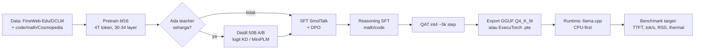

# Efficient LLM Architecture for Edge Deployment: Rancangan <500M Params

> [!tip] Terkait (Graph)
> - [[llm_architecture/frontier-efficient-llm-architectures-2026|Frontier Efficient LLM Architectures (2026)]]
> - [[llm_architecture/attention_variants|Attention Variants: KV-cache & RoPE taxonomy]]
> - [[quantization-precision/README|Quantization & Precision]]
> - [[pretrain_llms/gatra/README|Gatra: Indonesia-first small LM]]

## Ringkasan eksekutif

Untuk model <500M yang jalan di ponsel/CPU, **arsitektur adalah faktor kedua; anggaran token, kualitas data, dan quantization adalah faktor pertama**. Rekomendasi berbasis bukti primer:

1. **Target realistis 270M–500M**, int4 weight-only (Q4_K ≈ 4,5 bpw), konteks 4K untuk chat, CPU-first runtime (llama.cpp/GGUF) sebagai baseline.
2. **Dense transformer, deep-thin**: ~30 layer di 125M, ~31–32 di 350M, ~34 di 500M. MobileLLM menunjukkan depth mengalahkan width di sub-1B; SmolLM2 dan Granite memakai bentuk yang sama.
3. **GQA 3–5 KV head** (bukan MHA): memotong KV cache 3–8× dengan penurunan kualitas kecil. KV cache sering lebih besar dari bobot int4 pada konteks panjang.
4. **SwiGLU rasio 2,6–2,7×**, pre-RMSNorm, RoPE (θ naik sesuai konteks), embedding tied, vocab 32k–50k.
5. **Token budget 4T (±10k token/param)** sebagai default 2025–2026; batas repetition efektif ≈4 epoch data unik. Untuk 500M, 4T token lebih menentukan kualitas daripada trik arsitektur.
6. **Hybrid conv/Mamba hanya jika long-context adalah requirement utama** dan runtime target punya kernel yang matang; kalau tidak, keuntungan teoretis habis oleh fallback.
7. **QAT int4 pasca-pretraining** (≈5k step) adalah jalur murah; ternary/BitNet belum punya bukti di bawah 700M.

---

## 1. Definisi "edge" dan batasan yang mengikat

"Edge" di sini = ponsel flagship, tablet, laptop konsumen, SBC (Raspberry Pi/Jetson), dan NPU kelas mobile. Bukan workstation.

| Constraint | Angka tipikal | Konsekuensi desain |
|---|---|---|
| Flash/storage | 0,1–2 GB per app | Bobot int4 350M ≈ 198 MB; 500M ≈ 277 MB |
| RAM untuk model | 0,5–2 GB | Bobot + KV cache + runtime harus muat bersamaan |
| Memory bandwidth | LPDDR5 ±30–60 GB/s efektif | Decode batch-1 **memory-bound**, bukan compute-bound |
| Compute | 5–40 TOPS NPU (INT8/INT4) | Prefill compute-bound; TTFT ditentukan prompt |
| Power/thermal | 3–6 W sustained | Throttling setelah puluhan detik; benchmark burst menipu |
| Latency | TTFT <1 s, decode ≥20–30 tok/s | Decode ≥30 tok/s butuh bytes/token ≤ bandwidth/30 |
| Runtime | CPU, GPU, NPU, WebGPU | Operator coverage menentukan; satu op fallback bisa mematikan NPU |

Implikasi: **setiap byte yang dibaca per token adalah biaya latency**. Arsitektur yang menang di edge adalah yang meminimalkan bytes-per-token (bobot + KV), bukan yang meminimalkan FLOPs saja.

---

## 2. Formalism: anggaran parameter, KV cache, dan roofline

### 2.1 Parameter count dengan GQA

Untuk decoder-only dengan $L$ layer, $d$ = `d_model`, $n_h$ head query, $n_{kv}$ head KV, $d_{head}=d/n_h$, FFN SwiGLU $d_{ff}$, vocab $V$, embedding tied:

$$
N \;=\; \underbrace{V d}_{\text{embedding (tied)}} \;+\; L\Big(\underbrace{2d^2 + 2d\,n_{kv}d_{head}}_{\text{attention (Q, K, V, O)}} \;+\; \underbrace{3d\,d_{ff}}_{\text{SwiGLU}} \;+\; \underbrace{2d}_{\text{2× RMSNorm}}\Big) \;+\; d
$$

Suku $2d^2 + 2d n_{kv} d_{head}$ berasal dari $W_Q, W_O \in \mathbb{R}^{d\times d}$ dan $W_K, W_V \in \mathbb{R}^{d \times n_{kv}d_{head}}$. Dengan MHA ($n_{kv}=n_h$) ini kembali ke $4d^2$.

### 2.2 KV cache

$$
M_{KV} \;=\; 2 \cdot L \cdot n_{kv} \cdot d_{head} \cdot S \cdot b \quad \text{bytes}
$$

dengan $S$ = panjang konteks dan $b$ = bytes per elemen (2 untuk bf16/fp16, 1 untuk int8). Faktor 2 = key + value.

### 2.3 Decode roofline

Pada batch 1, tiap token baru membaca seluruh bobot dan seluruh KV cache:

$$
\text{tok/s} \;\lesssim\; \frac{BW_{\text{eff}}}{W_{\text{bytes}} + M_{KV}(S)}
$$

Ini batas atas; kernel overhead, tokenizer, dan thermal membuat realisasi 50–70% dari batas. Arah constraint ini dikonfirmasi catatan llama.cpp: "we are memory bound on the CPU and the 6-bit model is ~44% larger than the 4-bit" ([llama.cpp PR #1684](https://github.com/ggml-org/llama.cpp/pull/1684)). Pope et al. menunjukkan rezim yang sama: "29ms per token during generation (using int8 weight quantization)" pada batch kecil versus "76% MFU during large-batch-size processing of input tokens" ([arXiv:2211.05102](https://arxiv.org/abs/2211.05102)).

### 2.4 Prefill

$$
\text{FLOPs}_{\text{prefill}} \;\approx\; 2NT
$$

untuk $N$ parameter dan $T$ token prompt. Prefill **compute-bound**; decode **memory-bound**. Optimasi keduanya terpisah: TTFT vs kecepatan streaming.

### 2.5 Contoh minimal: trace 350M

Konfigurasi: 31 layer, $d=960$, 15 head Q / 5 KV, $d_{head}=64$, $d_{ff}=2560$, $V=49{,}152$, tied.

- Parameter: **352,0M**.
- Bobot int4 Q4_K (4,5 bpw): $352\text{M}\times 4{,}5/8 \approx$ **198 MB**.
- KV bf16: $2\cdot31\cdot5\cdot64\cdot2 = 39{,}680$ B/token = **38,75 KiB/token**.
  - 4K context: **155 MiB**; 8K: 310 MiB.
- Decode ceiling di bandwidth efektif 30 GB/s: $(198+162{,}5)\ \text{MB} / 30\ \text{GB/s} \approx 12{,}0$ ms/token → **≈83 tok/s** batas atas (realistis 40–60 tok/s).
- Prefill 4K: $2\cdot3{,}52\times10^8\cdot4096 \approx 2{,}88$ TFLOP. Di NPU 10 TOPS dengan efisiensi 20% → **≈1,4 s TTFT** (kalkulasi kasar).

Pesan: pada 350M, **KV cache 4K hampir sebesar bobot int4**. Konteks 8K+ menggandakan bytes/token dan langsung memotong decode speed.

---

## 3. Design space: bukti per knob

| Knob | Bukti utama | Rekomendasi <500M |
|---|---|---|
| Depth vs width | MobileLLM ablation | 30 layer @125M; 31–32 @350M; 34 @500M |
| Attention | GQA paper; config model rilis | GQA, 3–5 KV head, head_dim 64 |
| KV policy | StreamingLLM, Gemma 3 | Window 2–4K + 4 sink token bila recall panjang tidak kritis |
| Posisi | RoPE vs ALiBi vs NoPE | RoPE θ=10k (≤4K), 100k–1e6 (≥8K) |
| FFN | GLU variants | SwiGLU, rasio 2,6–2,7× |
| Norm | RMSNorm, QK-norm, z-loss | Pre-RMSNorm; QK-norm di ≥350M |
| Embedding | Weight tying; config model | Tied, vocab 32k–50k |
| Hybrid | LFM2, Granite, Falcon-H1, Hymba | Dense default; hybrid hanya untuk long-context |
| Low precision | BitNet b1.58 | bf16 train + QAT int4; ternary belum terbukti <700M |
| MoE / early exit / MTP | Tidak ada studi <500M | Skip |

### 3.1 Depth mengalahkan width di bawah 1B

MobileLLM melakukan sweep terkontrol pada ±130M parameter: 4 layer/d1280 (163,2M) menghasilkan rata-rata 43,3, sedangkan 24 layer/d576 (132,4M) dan 30 layer/d512 (135,0M) sama-sama menghasilkan **44,8** — model dalam menang meski ±30M parameter lebih sedikit. Di 350M, 32 layer/d896 (49,8) mengalahkan 5 layer/d2048 (47,1).

> [!quote] MobileLLM, [arXiv:2402.14905](https://arxiv.org/abs/2402.14905), App. C
> "shallow architectures with fewer than 10 layers perform poorly... the optimal depth is found to be near 30 layers for sub-billion scale models."

Manfaat depth mendatar setelah ~30 layer (42L = 44,5; 62L = 44,7 pada 125M), jadi menambah layer di atas ~34 hanya menambah latency. SmolLM2 (30L/576 di 135M; 32L/960 di 360M) dan Granite-4.0-H-350M (32L/768) mengikuti pola ini.

### 3.2 Attention: GQA hampir gratis, KV cache tagihan sebenarnya

Semua model produksi ≤500M yang disurvei memakai GQA: Qwen2.5-0.5B **14Q/2KV**, SmolLM2-135M **9Q/3KV**, SmolLM2-360M **15Q/5KV**, Falcon-H1-0.5B **8Q/2KV**.

> [!quote] GQA, [arXiv:2305.13245](https://arxiv.org/abs/2305.13245)
> "uptrained GQA achieves quality close to multi-head attention while being almost as fast as multi-query attention."

Konversi MHA→GQA lewat uptraining hanya butuh ~5% compute pretraining, jadi keputusan ini bisa direvisi di akhir tanpa retrain penuh. Dampak KV cache konkret (bf16):

| Model | L | KV head | KV/token | @4K | @32K |
|---|---:|---:|---:|---:|---:|
| Qwen2.5-0.5B | 24 | 2 | 12 KiB | 48 MiB | 384 MiB |
| SmolLM2-135M | 30 | 3 | 22,5 KiB | 90 MiB | 720 MiB |
| SmolLM2-360M | 32 | 5 | 40 KiB | 160 MiB | 1,25 GiB |

Alternatif untuk konteks panjang: sliding window (Mistral-7B: `sliding_window: 4096`; Gemma 2/3: local + global) dan attention sinks. StreamingLLM mempertahankan hanya sink awal:

> [!quote] StreamingLLM, [arXiv:2309.17453](https://arxiv.org/abs/2309.17453)
> "StreamingLLM simply keeps the attention sink tokens' KV (with just 4 initial tokens sufficing) together with the sliding window's KV."

Catatan: klaim "22,2× speedup" di paper itu dibandingkan dengan *recomputation* sliding window, bukan full attention. Windowing membuang kemampuan retrieval eksak di luar window — untuk chat edge ini biasanya tradeoff yang benar.

### 3.3 Posisi: RoPE, base diskalakan dengan konteks

Semua model ≤500M yang disurvei memakai RoPE, dengan θ naik sesuai konteks: SmolLM2-135M θ=10k (2K/8K), SmolLM2-360M θ=100k, Qwen2.5-0.5B θ=1e6 (32K), Falcon-H1-0.5B θ=1e11 (16K).

ALiBi kompetitif secara perplexity (1,3B model extrapolate 1024→2048 "the same perplexity... 11% faster and using 11% less memory", [arXiv:2108.12409](https://arxiv.org/abs/2108.12409)) tetapi tidak dipakai model rilis baru. NoPE lebih baik lagi di [arXiv:2305.19466](https://arxiv.org/abs/2305.19466) ("NoPE outperforms other explicit positional encoding methods while requiring no additional computation"), tapi hanya jika pretraining mencakup panjang target; bukan drop-in. **Default: RoPE.**

### 3.4 FFN: SwiGLU 2,6–2,7×, bukan 4×

SwiGLU punya tiga matriks, sehingga lebar FFN parameter-matched turun:

> [!quote] GLU Variants, [arXiv:2002.05202](https://arxiv.org/abs/2002.05202)
> "for the GLU-variant-based FFN layers, which have three weight matrices instead of two, we reduce the hidden layer to $d_{ff}=2048$" (dari 3072 untuk $d=768$).

Itu 2/3 dari $4d$ = 2,67d. SmolLM2-135M (1536/576) dan SmolLM2-360M (2560/960) persis 2,67×; Granite-350M juga 2,67×. Turun ke ~2,0× (Falcon-H1) menghemat parameter tetapi membuang kapasitas yang sulit dikembalikan lewat depth.

### 3.5 Normalisasi dan stabilitas

Semua config memakai **pre-norm RMSNorm**, `attention_bias: false`, `attention_dropout: 0.0`, tanpa bias MLP.

> [!quote] RMSNorm, [arXiv:1910.07467](https://arxiv.org/abs/1910.07467)
> "RMSNorm is computationally simpler and thus more efficient than LayerNorm."

QK-norm mencegah divergensi akibat pertumbuhan logit attention ([arXiv:2302.05442](https://arxiv.org/abs/2302.05442)); bukti empirisnya di 8B/22B, jadi di ≤500M perlakukan sebagai asuransi murah. z-loss PaLM $10^{-4}\log^2 Z$ ([arXiv:2204.02311](https://arxiv.org/abs/2204.02311)) dan logit soft-capping Gemma 2 ([arXiv:2408.00118](https://arxiv.org/abs/2408.00118)) juga murah, tetapi belum diuji terkontrol di sub-500M. Instabilitas tetap muncul di model kecil pada LR tinggi ([arXiv:2309.14322](https://arxiv.org/abs/2309.14322)); mitigasinya sama: warmup, weight decay, QK-norm, z-loss.

### 3.6 Embedding, vocab, dan tying

> [!quote] Weight tying, [arXiv:1608.05859](https://arxiv.org/abs/1608.05859)
> "When training language models, we recommend tying the input embedding and this output embedding."

Tying lebih penting di <500M karena embedding bisa mendominasi parameter: Qwen2.5-0.5B punya embedding 151.936×896 ≈ **136M (27% model)**; SmolLM2 49.152×576 ≈ 28M (21%). Gemma 3 270M ekstrem: 262k vocab menghabiskan ~170M parameter, menyisakan ~100M untuk 18 blok transformer ([Google blog](https://developers.googleblog.com/en/introducing-gemma-3-270m/)).

Untuk bahasa beraksara Latin (termasuk Indonesia), **vocab 32k–50k adalah sweet spot**: tokenizer BPE Latin tidak mengalami inflasi struktural, dan vocab besar hanya menambah bobot embedding + biaya output softmax. Byte tokenizer (vocab 256) menghindari OOV tetapi memperpanjang sequence ~2–4× vs BPE untuk teks Latin — tradeoff yang buruk untuk edge karena KV cache dan jumlah token naik.

### 3.7 Hybrid non-attention: nyata, tapi terikat runtime

- **LFM2-350M**: 16 blok, 10 double-gated convolution + 6 GQA. Hanya 6 layer yang punya KV cache penuh → KV 4K = 48 MiB, jauh lebih murah dari SmolLM2-360M. Vendor mengklaim "2× faster decode and prefill on CPU compared to Qwen3" ([LFM2 report, arXiv:2511.23404](https://arxiv.org/abs/2511.23404)).
- **Granite-4.0-H-350M**: 32 layer, hanya 4 attention + 28 Mamba-2, NoPE, 15T token, Apache-2.0. IBM menyatakan "work to fully optimize throughput in these runtimes [llama.cpp, MLX] is still ongoing" ([announcement](https://www.ibm.com/new/announcements/ibm-granite-4-0-hyper-efficient-high-performance-hybrid-models)).
- **Falcon-H1-0.5B**: Mamba-2 dan attention paralel di 36 blok; 521,4M total (sedikit di atas 500M). Family paper: [arXiv:2507.22448](https://arxiv.org/abs/2507.22448).
- **Hymba-125M/350M**: hybrid-head attention+Mamba, tetapi hanya checkpoint 1,5B yang dirilis; bobot 125M/350M tidak tersedia dan angka token di paper saling bertentangan.
- **Mamba-2 370M**: retrieval "near-perfect" pada 256K context setelah continued pretraining ([arXiv:2410.07145](https://arxiv.org/abs/2410.07145)), tetapi tanpa checkpoint produksi ekosistem luas.

**Aturan keputusan:** pilih hybrid hanya jika (a) konteks ≥8K adalah fitur produk, dan (b) runtime target (llama.cpp/MLX/NPU) punya kernel khusus untuk conv/SSM. Jika tidak, dense transformer lebih cepat di dunia nyata.

### 3.8 Quantization-aware architecture

- **BitNet b1.58**: ukuran 700M/1,3B/3B/3,9B; di 700M memory 2,08→0,80 GB (2,6×) dan latency 1,18→0,96 ms, tetapi PPL 12,33→12,87; paritas baru muncul di 3B ([arXiv:2402.17764](https://arxiv.org/abs/2402.17764)). **Tidak ada bukti ternary di <700M.**
- **MatMul-free LM 370M**: 24 layer, 15B token, zero-shot avg 40,3; 59,4 tok/s dan 70,8 mJ/token di embedded GPU ([arXiv:2406.02528](https://arxiv.org/abs/2406.02528)). Prototipe riset, butuh kernel kustom.
- **Kesimpulan:** untuk 270–500M, train bf16 lalu **QAT int4/int8 pasca-pretraining**. Jangan commit ke ternary dari awal kecuali siap menulis kernel sendiri.

### 3.9 Knob yang tidak layak di <500M

MoE, multi-token prediction (MTP), early exit, dan depthwise convolution tanpa bukti terkontrol di ≤500M. MoE khususnya salah untuk edge: ia menukar **memory** (constraint utama) dengan FLOPs (yang justru berlimpah relatif terhadap bandwidth). Skip.

---

## 4. Bukti dari model yang sudah rilis

Config di bawah dibaca dari `config.json` resmi/model card (akses 2026-10-20).

| Model | Params | L | d_model | Q/KV | FFN | Vocab | Ctx | Token |
|---|---:|---:|---:|---:|---:|---:|---:|---:|
| MobileLLM-125M | 124,6M | 30 | 576 | 9/3 | n/r | 32k | 2K | 1T |
| MobileLLM-350M | 345,3M | 32 | 960 | 15/5 | n/r | 32k | 2K | 1T |
| MobileLLM-R1-140M | 140,2M | 15 | 576 | 9/3 | 2048 | 128k | 32K | 4,2T |
| MobileLLM-R1-360M | 359,4M | 15 | 1024 | 16/4 | 4096 | 128k | 32K | 4,2T |
| SmolLM2-135M | 134,5M | 30 | 576 | 9/3 | 1536 | 49k | 8K | 2T |
| SmolLM2-360M | 361,8M | 32 | 960 | 15/5 | 2560 | 49k | 8K | 4T |
| Qwen2.5-0.5B | 494,0M | 24 | 896 | 14/2 | 4864 | 152k | 32K | 18T* |
| Gemma 3 270M | 270M | 18 | 640 | 4/1 | 2048 | 262k | 32K | 6T |
| LFM2-350M | 354,5M | 16† | 1024 | 16/8 | 4608 | 66k | 32K | 10T |
| LFM2.5-350M (2026) | 350M | 16† | 1024 | 16/8 | 6656 | 66k | 32K | 28T |
| Granite-4.0-H-350M | 340,3M | 32‡ | 768 | 12/4 | 2048 | 100k | 32K | 15T |
| MiniCPM4-0.5B | 433,9M | 24 | 1024 | 16/2 | 4096 | 73k | 32K | 1T |
| Falcon-H1-0.5B | 521,4M§ | 36 | 1024 | 8/2 | 2048 | 33k | 16K | n/d |
| Qwen3-0.6B§ | 751,6M | 28 | 1024 | 16/8 | 3072 | 152k | 32K | 36T* |

\* family-level; alokasi per ukuran tidak dipublikasikan. † 10 conv + 6 attention. ‡ 4 attention + 28 Mamba-2. § di atas 500M total; disertakan sebagai referensi.

Kualitas (harness berbeda — bandingkan hanya secara indikatif):

| Model | MMLU | GSM8K | HumanEval | Lain |
|---|---:|---:|---:|---|
| SmolLM2-135M | 31,5 | 1,4 | — | HellaSwag 42,1; ARC 43,9 |
| SmolLM2-360M | 35,8 | 3,2 | — | HellaSwag 54,5; ARC 53,0 |
| Qwen2.5-0.5B (base) | 47,5 | 41,8 | — | — |
| MobileLLM-R1-140M | — | 16,3 | 15,9 | MATH500 4,6 |
| MobileLLM-R1-360M | 26,8 | 39,4 | 32,9 | MATH500 13,4 |
| Gemma 3 270M (pre) | — | — | — | HellaSwag 40,9; ARC-c 29,0; PIQA 67,7 |
| LFM2-350M | 43,4 | 30,1 | — | IFEval 65,1; GPQA 27,5 |
| Granite-4.0-H-350M | 36,2 | 39,3 | — | IFEval 67,6 |
| Falcon-H1-0.5B | 55,0 | 60,2 | 36,0 | ARC-C 46,9; HellaSwag 56,3 |
| Qwen3-0.6B (base) | 52,4 | 60,9 | 30,5 | — |

**Yang dipelajari dari tabel:** (a) token budget ekstrem (Qwen 18T, Qwen3 36T, Granite 15T) menutup gap arsitektur; (b) vocab besar (Gemma 262k, Qwen 152k) memakan porsi parameter besar, jadi efektivitas per byte lebih rendah di edge; (c) model 350M yang bagus (LFM2, Falcon) memakai hybrid atau data/token lebih banyak, bukan trik arsitektur eksotis.

---

## 5. Resep training

### 5.1 Token budget: jauh di atas Chinchilla

Chinchilla menetapkan 20 token/param sebagai compute-optimal ([arXiv:2203.15556](https://arxiv.org/abs/2203.15556)). Edge membalik ekonomi: training dibayar sekali, inference selamanya. Sardana et al.:

> [!quote] Beyond Chinchilla-Optimal, [arXiv:2401.00448](https://arxiv.org/abs/2401.00448)
> "We find that model quality continues to improve as we scale token ratios. We do not find evidence of a 'saturation point'."

Batas praktisnya adalah repetition:

> [!quote] Data-Constrained LMs, [arXiv:2305.16264](https://arxiv.org/abs/2305.16264)
> "training with up to 4 epochs of repeated data yields negligible changes to loss compared to having unique data. However, with more repetition, the value of adding compute eventually decays to zero."

| Model | Params | Token | Token/param |
|---|---:|---:|---:|
| phi-1-small | 350M | 7B | 20 |
| MobileLLM-350M | 345M | 1T | 2,9k |
| SmolLM2-360M | 362M | 4T | 11,0k |
| SmolLM2-135M | 135M | 2T | 14,8k |
| MobileLLM-R1-140M | 140M | 4,2T | 30k |
| Qwen2.5-0.5B | 494M | 18T* | 36,7k |
| Qwen3-0.6B | 752M | 36T* | 60k |

Default 2025–2026 untuk ±400M: **4T token (±10k/param)**; 6–8T hanya jika volume inference tinggi dan data unik cukup.

### 5.2 Data: kualitas mengalahkan volume

Resep paling reproducible adalah SmolLM2: stage 1 60% FineWeb-Edu / 40% DCLM; stage decay 58% web (40/60 FineWeb-Edu/DCLM), 24% code, 14% math, 4% Cosmopedia. Untuk 135M/360M, **single-stage curated mix mengalahkan multi-stage**, dan "data curation has an especially outsized influence for smaller models" ([arXiv:2502.02737](https://arxiv.org/abs/2502.02737)).

- FineWeb-Edu: 33,6% MMLU dengan 38B token training (sebelumnya butuh 300B); ablasi 1,71B/350B menaikkan MMLU 33→37% ([arXiv:2406.17557](https://arxiv.org/abs/2406.17557)).
- DCLM: 7B model mencapai 64% MMLU pada 2,6T token terfilter dari 240T ([arXiv:2406.11794](https://arxiv.org/abs/2406.11794)).
- Cosmopedia: 25B token sintetis dari Mixtral-8x7B ([HF card](https://huggingface.co/datasets/HuggingFaceTB/cosmopedia)).
- TinyStories: bahasa Inggris koheren dari model <10M parameter ([arXiv:2305.07759](https://arxiv.org/abs/2305.07759)).
- phi-1-small (350M) mencapai 45% HumanEval dengan pipeline data textbook + 7B token ([arXiv:2306.11644](https://arxiv.org/abs/2306.11644)).
- Multilingual: FineWeb-2 mencakup 1.000+ bahasa; `ind_Latn` ±100,2M dokumen / 348,65 GB terfilter (±80–100B token estimasi) ([arXiv:2506.20920](https://arxiv.org/abs/2506.20920)). Untuk model Indonesia, campur 5–15% dengan English replay, lalu ablasi.

### 5.3 Distillation: kondisional, bukan default

Gemma 2 mendistilasi 2B/9B dari teacher 7B dan melaporkan ablasi 500B token: rata-rata 3 benchmark 60,3→67,7; PPL 7B→400M turun 19→17, 7B→200M 23→21 ([arXiv:2408.00118](https://arxiv.org/abs/2408.00118)). Tetapi MobileLLM mendistilasi Llama-2-7B ke 125M/350M dan menemukan KD "exhibits comparable or inferior accuracy to label-based training" dengan biaya 2,6–3,2× ([arXiv:2402.14905](https://arxiv.org/abs/2402.14905)).

Bedanya rezim: student Gemma undertrained relatif kapasitas + teacher satu keluarga; student MobileLLM sudah overtrained + beda tokenizer. Distillation scaling law juga kondisional: KD menang "up to a compute level that scales predictably with student size", tetapi jika teacher juga harus dilatih, supervised learning umumnya lebih baik ([arXiv:2502.08606](https://arxiv.org/abs/2502.08606)); fitted student ≥546M, **tidak ada law untuk sub-500M**.

Jalur termurah adalah **data-side distillation**: MiniPLM memakai teacher 1,8B untuk memperbaiki korpus; 50B token hasil distilasi setara 118B token biasa (2,36× efisiensi) dengan ~200 MB storage vs 30 PB logits ([arXiv:2410.17215](https://arxiv.org/abs/2410.17215)).

**Aturan:** jalankan A/B 50B token sebelum commit. Jika student sudah 4T token dan teacher beda tokenizer, kemungkinan besar tidak menang; alihkan compute teacher ke post-training reasoning SFT.

### 5.4 Post-training

- **SFT:** SmolLM2 memakai SmolTalk 2 epoch, batch 128, seq 8192, LR 3e-4, dengan filtering sadar kapasitas untuk 135M/360M.
- **DPO:** UltraFeedback 2 epoch, LR 1e-6, β=0,5, batch 128, seq 1024.
- **Reasoning SFT:** MobileLLM-R1 dua tahap (instruction SFT → math/science/code reasoning SFT) membawa 360M dari MATH 5,2→19,2 dan GSM8K 7,4→23,8; pada 140M gain jauh lebih kecil (MATH 3,2→4,8), menandakan **capacity floor ±300M** untuk math reasoning ([arXiv:2509.24945](https://arxiv.org/abs/2509.24945)).
- **RL:** Qwen3 memilih distillation, bukan RL, untuk model kecil: on-policy KD lebih baik dan "approximately only 1/10 of the GPU hours" ([arXiv:2505.09388](https://arxiv.org/abs/2505.09388)). Tidak ada hasil ORPO/GRPO terkontrol di ≤500M yang ditemukan.

### 5.5 Stabilitas & hyperparameter

Setting yang teramati di model rilis:

| Komponen | Nilai | Sumber |
|---|---|---|
| LR | 3e-3 (SmolLM2-360M, WSD); 2e-3 (MobileLLM-350M, cosine); 3,45e-4 (Sardana 370M) | paper masing-masing |
| Batch | ±2M token (SmolLM2-1.7B); MobileLLM 1024 seq × 2048 | paper |
| Optimizer | AdamW, β=(0,9;0,95), wd=0,1, grad clip 1,0, bf16 | engineering judgment |
| Dropout | 0,0 pretraining; 0,1 hanya bila SFT overfit | engineering judgment |
| QAT | ±5.000 step pasca-pretraining ke int4/int8 ([arXiv:2503.19786](https://arxiv.org/abs/2503.19786)) | Gemma 3 |

μP memungkinkan transfer HP dari proxy 40M: "a 40M proxy beats GPT-3 6.7B at 7% of pretraining cost" ([arXiv:2203.03466](https://arxiv.org/abs/2203.03466)) — cara termurah menyetel LR/batch sebelum run 4T.

---

## 6. Deployment

### 6.1 Runtime dan format

| Runtime | Lisensi | Format | Backend | Quantization | Posisi |
|---|---|---|---|---|---|
| **llama.cpp** | MIT | GGUF | CPU ARM/x86, Metal, Vulkan, Hexagon | Q2–Q8 K-quants | Default CPU-first, cakupan perangkat terluas |
| **ExecuTorch** | BSD | `.pte` | XNNPACK, Vulkan, Core ML, QNN | backend-specific, PTQ/QAT | Jalur PyTorch mobile; butuh export per backend |
| **MLC-LLM** | Apache-2.0 | TVM library | iOS/Android/Web/WebGPU | q4f16_1, q3f16_1 | Compiler-driven, bagus untuk WebGPU |
| **ORT GenAI** | MIT | ONNX | XNNPACK, QNN, CoreML | EP-dependent | Windows/Android/iOS, API preview |
| **LiteRT-LM** | Apache-2.0 | `.litertlm` | GPU/NPU | INT4 checkpoint | Gemma-first, stack Google |
| **Core ML** | Proprietary | `.mlpackage` | CPU/GPU/ANE | FP16/quantized | Integrasi Apple terbaik, iOS-only |
| **MLX** | MIT | MLX arrays | Apple silicon | FP16/quantized | Mac/laptop, bukan ponsel |
| **QNN/Genie** | Proprietary | QNN graph | Hexagon NPU | vendor graph | Ceiling NPU Snapdragon, lock-in |
| **KleidiAI** | Apache-2.0 | micro-kernel | Arm CPU | INT4/INT8 | Bukan runtime; lapisan kernel |

Sumber: [llama.cpp](https://github.com/ggml-org/llama.cpp), [ExecuTorch](https://docs.pytorch.org/executorch/main/quantization-overview.html), [MLC-LLM](https://llm.mlc.ai/docs/compilation/configure_quantization.html), [ORT GenAI](https://onnxruntime.ai/docs/genai/), [LiteRT-LM](https://github.com/google-ai-edge/LiteRT-LM), [Core ML](https://developer.apple.com/documentation/coreml/mlcomputeunits), [MLX](https://github.com/ml-explore/mlx), [Qualcomm AI Hub](https://aihub.qualcomm.com/models), [KleidiAI](https://github.com/ARM-software/kleidiai).

### 6.2 Quantization

K-quants llama.cpp mengeksplisitkan biaya bit: Q2_K 2,5625 bpw, Q3_K 3,4375, **Q4_K 4,5**, Q5_K 5,5, Q6_K 6,5625; varian "mix" memberi bit lebih ke tensor sensitif ([PR #1684](https://github.com/ggml-org/llama.cpp/pull/1684)). Konsekuensi ukuran:

| Model | Q4_K (4,5 bpw) | Q8 (8,5 bpw) |
|---|---:|---:|
| 135M | 76 MB | 143 MB |
| 350M | 198 MB | 374 MB |
| 500M | 277 MB | 524 MB |

Metode post-training: GPTQ 3–4 bit "with negligible accuracy degradation" dan 3,25–4,5× speedup ([arXiv:2210.17323](https://arxiv.org/abs/2210.17323)); AWQ melindungi "only 1% salient weights" dan >3× speedup di mobile GPU ([arXiv:2306.00978](https://arxiv.org/abs/2306.00978)); SmoothQuant W8A8 "up to 1.56x speedup and 2x memory reduction" ([arXiv:2211.10438](https://arxiv.org/abs/2211.10438)); LLM.int8() "cut the memory needed for inference by half" dengan outlier 16-bit ([arXiv:2208.07339](https://arxiv.org/abs/2208.07339)).

Untuk <500M, **QAT lebih layak** karena beberapa poin error kuantisasi adalah fraksi kualitas yang lebih besar. Gemma 3 270M mengirim checkpoint QAT "enabling you to run the models at INT4 precision with minimal performance degradation" ([Google blog](https://developers.googleblog.com/en/introducing-gemma-3-270m/)).

### 6.3 Performa on-device terukur

| Model | Device / runtime | Quant | Hasil | Sumber |
|---|---|---|---|---|
| MobileLLM-125M | iPhone 13, ExecuTorch MPS | FP16 | execute **15,6 ms**; load 39,2 ms; init 1,36 s | [arXiv:2402.14905](https://arxiv.org/abs/2402.14905) §3.6 |
| MobileLLM-R1-140M | Galaxy S22, ExecuTorch | W4A8 | **>100 tok/s sampai 8K**; 129,67 @1K, 110,47 @8K | [arXiv:2509.24945](https://arxiv.org/abs/2509.24945) Table 10 |
| Gemma 3 270M | Pixel 9 Pro | INT4 QAT | **0,75% baterai untuk 25 percakapan** | [Google blog](https://developers.googleblog.com/en/introducing-gemma-3-270m/) |
| LFM2-350M | CPU, ExecuTorch 8da4w / llama.cpp Q4_0 | 4-bit | klaim vendor "2× faster decode and prefill than Qwen3" | [Liquid AI](https://www.liquid.ai/blog/liquid-foundation-models-v2-our-second-series-of-generative-ai-models) |
| SmolLM2-135M/360M | — | — | tidak ada latency ponsel first-party | [HF](https://huggingface.co/executorch-community/SmolLM2-135M) |
| Qwen2.5-0.5B | — | — | tidak ada latency ponsel first-party | [model card](https://huggingface.co/Qwen/Qwen2.5-0.5B-Instruct) |

Realitas publikasi: **angka tok/s ponsel untuk sub-500M sangat jarang**. Vendor lebih sering menerbitkan baterai, klaim relatif, atau tidak sama sekali. Setiap keputusan arsitektur harus disertai benchmark lokal.

### 6.4 Constraint edge yang mengubah desain

- **Cold start bukan gratis.** MobileLLM-125M butuh 1,36 s inisialisasi setelah 39 ms load di iPhone 13. Warm-up saat app start lebih penting daripada gain decode 10%.
- **Background execution dibatasi.** Core ML menyarankan `cpuOnly` "if your app might run in the background" ([Apple](https://developer.apple.com/documentation/coreml/mlcomputeunits)).
- **Thermal throttling nyata.** Apple mengekspos state `serious`/`critical`; benchmark harus sustained 5 menit, bukan burst 10 detik ([Apple](https://developer.apple.com/documentation/foundation/processinfo/thermalstate-swift.enum)).
- **NPU bersifat op-specific.** Satu operator tak didukung bisa memaksa fallback ke CPU dan menghapus keuntungan NPU; quantization ExecuTorch backend-specific.
- **Vocab mendominasi ukuran file.** Gemma 3 270M: 170M parameter embedding + 100M blok; di int4 tetap ±130–150 MB.
- **Konteks bersaing dengan bobot.** Qwen2.5-0.5B @32K butuh 384 MiB KV fp16 — lebih besar dari bobot int4-nya. Cap 4K kecuali produk butuh lebih.
- **Lisensi berbeda.** Qwen2.5-0.5B & SmolLM2 Apache-2.0; LFM2 `lfm1.0`; Gemma Terms; MobileLLM FAIR Noncommercial (tidak bisa dipakai komersial).

---

## 7. Rancangan yang direkomendasikan

### 7.1 Tiga tier arsitektur

Semua memakai: decoder-only, pre-RMSNorm, RoPE, SwiGLU, GQA, embedding tied, vocab 49.152, `attention_bias=false`.

| | **125M** | **350M** | **500M** |
|---|---|---|---|
| Layer $L$ | 30 | 31 | 34 |
| $d_{model}$ | 576 | 960 | 1152 |
| Q head / KV head | 9 / 3 | 15 / 5 | 18 / 3 |
| $d_{head}$ | 64 | 64 | 64 |
| $d_{ff}$ (2,67×) | 1536 | 2560 | 2816 |
| **Params** | **134,5M** | **352,0M** | **492,9M** |
| Bobot Q4_K | 76 MB | 198 MB | 277 MB |
| KV bf16/token | 22,5 KiB | 38,8 KiB | 25,5 KiB |
| KV @4K | 90 MiB | 155 MiB | 102 MiB |
| Konteks target | 2K | 8K | 16K |
| RoPE θ | 10k | 100k | 1e6 |

Catatan: 500M memakai 3 KV head (bukan 5) karena pada $d=1152$ biaya KV per layer sudah besar; tradeoff kualitas GQA 6:1 dapat diterima dan bisa di-uptrain nanti.

### 7.2 Blueprint 350M (default)

**Arsitektur.** 31 layer, d=960, 15Q/5KV, SwiGLU 2560, vocab 49.152 tied, RoPE θ=100k, pre-RMSNorm, QK-norm, context 8K, tanpa bias. Parameter 352M; Q4_K 198 MB; KV 4K 155 MiB.

**Training.**
1. Token budget 4T (±11,4k/param), repetition ≤4 epoch.
2. Data: 60/40 FineWeb-Edu/DCLM → code/math → decay 58% web / 24% code / 14% math / 4% Cosmopedia; 5–10% FineWeb-2 `ind_Latn` bila target Indonesia.
3. WSD schedule, warmup 2k, peak LR 1–3e-3 (sweep di proxy 40M dengan μP), decay 10–20%, batch ±1–2M token, AdamW β=(0,9;0,95), wd=0,1, clip 1,0, bf16, dropout 0.
4. Distillation: A/B 50B token di akhir; kalau menang, KD hanya 20% terakhir; kalau tidak, skip.
5. Post-training: SFT SmolTalk terfilter 2 epoch → DPO UltraFeedback 2 epoch (β=0,5, LR 1e-6) → reasoning SFT 1 epoch untuk math/code.
6. QAT int4 ±5k step; export GGUF Q4_K_M + ExecuTorch `.pte`; benchmark di device target.

**Deployment.** llama.cpp/GGUF sebagai baseline CPU-first; tambah ExecuTorch hanya jika butuh Core ML/QNN. Target: TTFT <1 s @1K prompt, decode 40–60 tok/s, RSS <600 MB @4K.

### 7.3 Yang harus dihindari

- Vocab >100k di model <500M (embedding mendominasi; Qwen 152k = 27% parameter, Gemma 262k = 63%).
- MHA penuh (KV cache 3–8× lebih besar tanpa gain kualitas sepadan).
- Konteks 32K default (KV > bobot int4; cap 4–8K kecuali perlu).
- Ternary/BitNet dari awal (belum terbukti <700M; QAT cukup).
- MoE/early-exit/MTP (tidak ada bukti <500M; MoE menukar memory).
- Distillation cross-tokenizer pada student yang sudah overtrained (MobileLLM: tidak menang, 2,6–3,2× biaya).

---

## 8. Implikasi untuk Gatra (lokal)

Proyek `pretrain_llms/gatra` saat ini: byte tokenizer (vocab 256), Gatra-1M (4 layer, d128, block 128) dan Gatra-10M (6 layer, d384, block 256), target roadmap 30M/100M. Berdasarkan bukti di atas:

1. **Byte tokenizer bertentangan dengan target edge <500M.** Vocab 256 membuat sequence 2–4× lebih panjang untuk teks Latin, sehingga KV cache dan jumlah token naik; embedding murah tetapi biaya inference berulang. Untuk Gatra-10M/100M, pertimbangkan BPE 32k–49k (SmolLM2/LLaMA tokenizer) dan ukur fertility pada korpus Indonesia sebelum commit.
2. **Depth perlu dinaikkan.** Gatra-10M 6 layer masih dangkal; MobileLLM menunjukkan ~30 layer optimal di ±125M. Untuk 30M–100M, coba 12–24 layer dengan $d$ 512–768, bukan menambah width.
3. **GQA & tied embedding** belum tentu ada di config Gatra; keduanya murah dan penting untuk edge.
4. **Token budget.** Config 10M saat ini 5.000 iterasi × 32 × 256 = 41M token (±3,8 token/param). Untuk kualitas kelas SmolLM2, target 10k token/param = ±107M token untuk Gatra-10M, 1T untuk Gatra-100M — jauh di atas config sekarang; ini keputusan compute, bukan arsitektur.
5. **Roadmap 100M** sebaiknya langsung ke desain 125M tier di §7.1 (30 layer, d576, 9/3, vocab 49k) daripada memperbesar konfigurasi 10M.

---

## 9. Batas riset dan pertanyaan terbuka

- **Tidak ada distillation scaling law untuk student <500M** (Busbridge hanya fit ≥546M). Keputusan KD harus empiris.
- **Angka tok/s ponsel first-party sangat jarang** untuk SmolLM2/Qwen2.5; klaim "2×" LFM2 adalah relatif vendor, bukan absolut.
- **Tidak ada studi terkontrol** untuk ORPO/GRPO, fp8, atau QAT ablation di ≤500M.
- **Hymba 125M/350M tidak dirilis**; angka token di paper saling bertentangan.
- **Gemma 3 270M gated**; sebagian config berasal dari mirror, bukan repo resmi.
- **Hybrid vs dense pada runtime nyata** belum ada benchmark netral; klaim keunggulan hybrid sering diukur di kernel khusus.
- **Threshold kualitas 350M vs 500M** bergantung task; 500M bukan target kualitas, melainkan batas biaya. Uji 135M/270M/360M/500M pada task aktual dan pilih yang terkecil yang lulus.

---

## 10. Referensi primer

**Arsitektur & model**

- MobileLLM — https://arxiv.org/abs/2402.14905
- MobileLLM-R1 — https://arxiv.org/abs/2509.24945
- SmolLM2 — https://arxiv.org/abs/2502.02737 ; config: https://huggingface.co/HuggingFaceTB/SmolLM2-360M
- Qwen2.5 — https://arxiv.org/abs/2412.15115 ; config: https://huggingface.co/Qwen/Qwen2.5-0.5B ; card: https://huggingface.co/Qwen/Qwen2.5-0.5B-Instruct
- Qwen3 — https://arxiv.org/abs/2505.09388 ; card: https://huggingface.co/Qwen/Qwen3-0.6B
- Gemma 3 270M — https://developers.googleblog.com/en/introducing-gemma-3-270m/
- Gemma 3 tech report — https://arxiv.org/abs/2503.19786
- LFM2 report — https://arxiv.org/abs/2511.23404 ; config: https://huggingface.co/LiquidAI/LFM2-350M
- Granite-4.0-H-350M — https://huggingface.co/ibm-granite/granite-4.0-h-350m ; https://www.ibm.com/new/announcements/ibm-granite-4-0-hyper-efficient-high-performance-hybrid-models
- Falcon-H1 — https://arxiv.org/abs/2507.22448 ; https://huggingface.co/tiiuae/Falcon-H1-0.5B-Base
- MiniCPM4 — https://arxiv.org/abs/2506.07900
- Hymba — https://arxiv.org/abs/2411.13676
- GQA — https://arxiv.org/abs/2305.13245
- MQA — https://arxiv.org/abs/1911.02150
- RoPE — https://arxiv.org/abs/2104.09864
- ALiBi — https://arxiv.org/abs/2108.12409
- NoPE — https://arxiv.org/abs/2305.19466
- GLU variants — https://arxiv.org/abs/2002.05202
- RMSNorm — https://arxiv.org/abs/1910.07467
- Weight tying — https://arxiv.org/abs/1608.05859
- QK-norm — https://arxiv.org/abs/2302.05442
- PaLM z-loss — https://arxiv.org/abs/2204.02311
- Gemma 2 soft-capping & distillation — https://arxiv.org/abs/2408.00118
- StreamingLLM — https://arxiv.org/abs/2309.17453
- Mamba-2 retrieval — https://arxiv.org/abs/2410.07145
- RWKV-7 — https://arxiv.org/abs/2503.14456
- BitNet b1.58 — https://arxiv.org/abs/2402.17764
- BitNet 2B4T — https://arxiv.org/abs/2504.12285
- MatMul-free LM — https://arxiv.org/abs/2406.02528

**Training & data**

- Chinchilla — https://arxiv.org/abs/2203.15556
- Beyond Chinchilla-Optimal — https://arxiv.org/abs/2401.00448
- Over-training scaling — https://arxiv.org/abs/2403.08540
- Data-constrained LMs — https://arxiv.org/abs/2305.16264
- FineWeb — https://arxiv.org/abs/2406.17557
- FineWeb-2 — https://arxiv.org/abs/2506.20920
- DCLM — https://arxiv.org/abs/2406.11794
- Cosmopedia — https://huggingface.co/datasets/HuggingFaceTB/cosmopedia
- TinyStories — https://arxiv.org/abs/2305.07759
- phi-1 — https://arxiv.org/abs/2306.11644
- phi-1.5 — https://arxiv.org/abs/2309.05463
- MiniPLM — https://arxiv.org/abs/2410.17215
- Distillation scaling laws — https://arxiv.org/abs/2502.08606
- MiniLM — https://arxiv.org/abs/2002.10957
- μP — https://arxiv.org/abs/2203.03466
- Training instabilities — https://arxiv.org/abs/2309.14322
- TinyLlama — https://arxiv.org/abs/2401.02385

**Deployment**

- llama.cpp — https://github.com/ggml-org/llama.cpp ; K-quants PR — https://github.com/ggml-org/llama.cpp/pull/1684
- ExecuTorch — https://docs.pytorch.org/executorch/main/quantization-overview.html
- MLC-LLM — https://llm.mlc.ai/docs/compilation/configure_quantization.html
- ONNX Runtime GenAI — https://onnxruntime.ai/docs/genai/
- LiteRT-LM — https://github.com/google-ai-edge/LiteRT-LM
- Core ML — https://developer.apple.com/documentation/coreml/mlcomputeunits
- MLX — https://github.com/ml-explore/mlx
- Qualcomm AI Hub — https://aihub.qualcomm.com/models
- KleidiAI — https://github.com/ARM-software/kleidiai
- GPTQ — https://arxiv.org/abs/2210.17323
- AWQ — https://arxiv.org/abs/2306.00978
- SmoothQuant — https://arxiv.org/abs/2211.10438
- LLM.int8() — https://arxiv.org/abs/2208.07339
- Roofline inference — https://arxiv.org/abs/2211.05102
- LFM2 announcement — https://www.liquid.ai/blog/liquid-foundation-models-v2-our-second-series-of-generative-ai-models
- SmolLM2-135M ExecuTorch — https://huggingface.co/executorch-community/SmolLM2-135M
- Apple ThermalState — https://developer.apple.com/documentation/foundation/processinfo/thermalstate-swift.enum
- Gemma Terms — https://ai.google.dev/gemma/terms

Semua URL diakses 2026-10-20.
