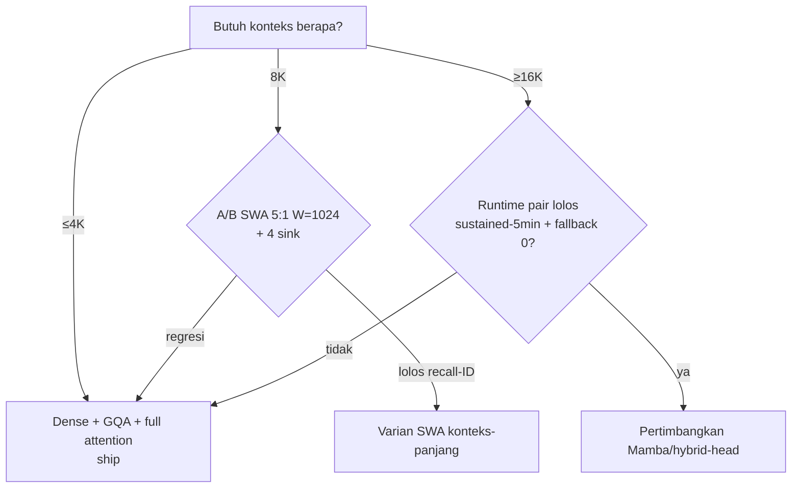

# Alternatif Arsitektur vs Baseline Gatra-300M (2026-10-22)

> [!tip] Terkait (Graph)
> - [[pretrain_llms/gatra/docs/efficient-llm-architecture-edge-under-500m-2026-10-20|Baseline edge-architecture 2026-10-20]]
> - [[pretrain_llms/gatra/docs/research/gatra-300m-arch-2026-10-22|Gatra-300M arch (baseline yang dibandingkan)]]
> - [[pretrain_llms/gatra/docs/research/arch-efficient-sub500m-2026-10-22|Validation note arsitektur]]
> - [[pretrain_llms/gatra/docs/research/edge-deployment-quant-runtime-2026-10-22|Deployment & runtime note]]
> - [[pretrain_llms/gatra/README|Gatra]]

**Baseline yang dibandingkan:** dense 28L / d960 / 15Q-3KV / SwiGLU 2560 / V32k tied / RoPE θ=100k / full attention @4K → 299.9M params, KV bf16 21.0 KiB/tok (84.0 MiB @4K), Q4_K ≈168.7 MB. Detail di [[gatra-300m-arch-2026-10-22|arsitektur 300M]] §1.

**TL;DR:** tidak ada alternatif yang mengalahkan dense+GQA+full-attention sebagai baseline pada konteks 4K, karena KV-cache base (84 MiB) masih lebih kecil dari bobot (169 MB) — tagihan KV belum cukup besar untuk membenarkan kompleksitas apapun. Satu-satunya A/B yang layak: **SWA 5:1 ala Gemma**, dan hanya jika produk menuntut ≥8K.

| Alternatif | Cara hemat KV | Bukti kualitas ≤500M | Runtime edge | vs Base 300M | Verdict |
|---|---|---|---|---|---|
| **SWA + global (5:1)** | Layer lokal cache $W$, bukan $S$ | Gemma-3-270M produksi; ablasi window≈tanpa rusak ppl | Nol risiko (pure masking) | @4K W=1024 → ~30 MiB (2.8×); W=512 → ~21 MiB (4×) | **Satu-satunya A/B layak** (trigger: butuh ≥8K) |
| **Mamba / Mamba-2** | State konstan, tanpa KV tumbuh | 370M near-perfect retrieval 256K (continued pretrain) | CPU ada; GPU/NPU second-class; Q4_K kecil gibberish | KV konstan, recall eksak kalah, kernel risk | **Tolak** (base); riset CPU-only |
| **Conv hybrid (LFM2)** | Hanya 6/16 layer KV penuh | Klaim vendor 2× CPU vs Qwen3 (10T token) | ExecuTorch OK pasangan terdaftar; conv tanpa kernel NPU → fallback | Cepat karena NAS, bukan conv gratis | **Tolak** |
| **Hybrid-head (Hymba/Falcon-H1)** | Attention+SSM paralel + KV-sharing | Falcon-H1-0.5B MMLU 55.0/GSM8K 60.2 (tapi 521M + lisensi Falcon) | llama.cpp CPU OK; Metal/NPU bolong | Skor terbaik, biaya integrasi tertinggi | **Tolak** |
| **MLA (DeepSeek)** | Cache laten $d_c L$, bukan $2Ln_{kv}d_{head}$ | **Nol bukti ≤500M** | Invasif (decoupled-RoPE + serving khusus) | Butuh $d_c<384$ sekadar impas vs GQA-3KV | **Tolak** |
| **Linear/gated (GLA, DeltaNet, RWKV-7)** | RNN linear, state konstan | Gated DeltaNet 1.3B > Mamba/GLA; RWKV-7 0.19–2.9B Apache-2.0 | Kernel `fla`/kustom; tak ada di llama.cpp | Recall diskon, ekosistem terpisah | **Tolak**; pantau |
| **Sparse trainable (InfLLM)** | Tiap token hitung <5% token | Hanya MiniCPM4-8B/0.5B @128K | Training kernel khusus | Overhead routing > hemat di 4K | **Tolak** |

---

## 1. SWA + global layers — satu-satunya A/B yang layak

Mekanisme Gemma 3, dinyatakan eksplisit sebagai solusi KV-cache:

> [!quote] Gemma 3 Technical Report, [arXiv:2503.19786](https://arxiv.org/abs/2503.19786)
> "We also change the architecture of the model to reduce the KV-cache memory that tends to explode with long context. This is achieved by increasing the ratio of local to global attention layers, and keeping the span on local attention short."

Ablasinya memberi lampu hijau kuantitatif: *"The sliding window can be reduced significantly without impacting perplexity"* ([sama](https://arxiv.org/abs/2503.19786)). Dan Gemma-3-270M adalah bukti produksi tepat di skala kita — 5:1 local:global, SW 512, head_dim 256, 4Q/1KV (cf. [[edge-deployment-quant-runtime-2026-10-22|deployment note]] §1.4, [[arch-efficient-sub500m-2026-10-22|validation]] §2.8).

### Formalism: KV-cache SWA

Layer lokal menyimpan $W$ token terakhir, bukan $S$:

$$
M_{SWA} \;=\; 2\,b\,n_{kv}d_{head}\,\big(L_{local}\cdot W + L_{global}\cdot S\big)
$$

dengan $b$ = bytes/elemen. Untuk base 300M, per-layer per-token = $2\cdot3\cdot64\cdot2 = 768$ B. Dengan 28 layer pola 5:1 → 24 lokal + 4 global:

| Konfigurasi | KV @4K | vs full 84 MiB |
|---|---:|---:|
| Full attention (base) | 84.0 MiB | 1× |
| SWA 5:1, $W{=}1024$ | ~30 MiB | 2.8× hemat |
| SWA 5:1, $W{=}512$ | ~21 MiB | 4× hemat |

### Kenapa tetap bukan default

Pada 4K, 84 MiB < 169 MB bobot — decode masih didominasi bobot, bukan KV (roofline: $\text{tok/s} \lesssim BW_{eff}/(W_{bytes}+M_{KV})$). SWA baru membalik persamaan di @8K (KV full 168 MiB ≈ bobot) atau @16K+. Ditambah catatan StreamingLLM:

> [!quote] StreamingLLM, [arXiv:2309.17453](https://arxiv.org/abs/2309.17453)
> "keeping the KV of initial tokens will largely recover the performance of window attention"

dengan *"just 4 initial tokens sufficing"* ([sama](https://arxiv.org/abs/2309.17453)) — tetapi divalidasi di model ≥2.9B, **bukan** ≤500M (cf. [[arch-efficient-sub500m-2026-10-22|validation]] §3). Windowing membuang recall eksak di luar window; untuk chat ID umum itu tradeoff yang belum terukur di skala kita. **Ship full-attention; A/B SWA 5:1 + $W{=}1024$ + 4 sink token hanya sebagai varian konteks-panjang (eval di 8K, gate: recall-ID tanpa regresi).**

---

## 2. Mamba / Mamba-2 / SSM — kuat di kertas, rapuh di dua titik

Titik kuatnya nyata dan terukur di skala kita:

> [!quote] Mamba-2 retrieval, [arXiv:2410.07145](https://arxiv.org/abs/2410.07145)
> "Mamba-2 with 370M parameters achieves near-perfect retrieval on a 256K context length, outperforming similarly sized transformer models"

**Rapuh #1 — forgetting harus dipelajari, dan itu mahal.** Model RNN harus belajar melupakan token lama, dan itu hanya terjadi bila panjang training melebihi kapasitas state — *"the minimum training length required for the model to learn forgetting scales linearly with the state size"* (Stuffed Mamba, Tsinghua). Resep 3T/4K kita belum tentu cukup panjang untuk state yang dipakai retrieval 256K — dua target yang saling tarik, tanpa ablation ≤500M yang memetakan tradeoff-nya.

**Rapuh #2 — runtime edge second-class.** Kontributor llama.cpp sendiri:

> [!quote] llama.cpp Mamba support, [PR #5328](https://github.com/ggml-org/llama.cpp/pull/5328)
> "I did not implement GPU kernels for the new operators"

dan *"the more a Mamba model is quantized, the more likely the model will output gibberish (especially with smaller models like mamba-130m at Q4_K)"* ([sama](https://github.com/ggml-org/llama.cpp/pull/5328)). Granite hybrid end-to-end + Metal masih open (cf. [[edge-deployment-quant-runtime-2026-10-22|deployment note]] §2.5). **Mamba di edge hari ini = CPU-only + QAT berisiko.** Tolak untuk base 300M; jalur riset CPU-only terpisah diperbolehkan.

---

## 3. Conv hybrid (LFM2-style) — cepat karena NAS, bukan karena conv gratis

> [!quote] LFM2 Technical Report, [arXiv:2511.23404](https://arxiv.org/abs/2511.23404)
> "Using hardware-in-the-loop architecture search under edge latency and memory constraints, we obtain a compact hybrid backbone that combines gated short convolutions with a small number of grouped query attention blocks, delivering up to 2x faster prefill and decode on CPUs compared to similarly sized models."

Frasa kuncinya: *hardware-in-the-loop architecture search*. LFM2-350M (10 conv + 6 GQA, 10T token, FFN 6656 = 6.5×) cepat karena dicari dengan loop hardware + kernel ExecuTorch yang cocok, bukan karena conv secara umum lebih cepat. Tanpa NAS yang sama, mengadopsi "conv hybrid" hanya mengambil risikonya — op conv tanpa kernel NPU memaksa fallback ke CPU di dalam graph NPU (cf. [[edge-deployment-quant-runtime-2026-10-22|deployment note]] §1.4) — tanpa kecepatan yang diklaim. **Tolak.** (LFM2.5-350M 28T-token masih klaim vendor tanpa report primer per [[edge-deployment-quant-runtime-2026-10-22|deployment note]] §2.7.)

---

## 4. Hybrid-head (Hymba / Falcon-H1) — skor terbaik, biaya tertinggi

Falcon-H1 adalah skor terkuat di kelas ≤500M (MMLU 55.0 / GSM8K 60.2 / HumanEval 36.0, [model card](https://huggingface.co/tiiuae/Falcon-H1-0.5B-Base)) dengan desain *"combine attention and Mamba-2 heads in parallel"* yang rasio attention:SSM-nya *"can be adjusted independently"* ([arXiv:2507.22448](https://arxiv.org/abs/2507.22448)). Hymba (ICLR 2025) mengklaim *"11.67× cache size reduction, and 3.49× throughput"* di 1.5B lewat attention-head + SSM-head paralel + meta token + cross-layer KV sharing + partial SWA.

Tetapi: Falcon-H1 total 521M (di atas budget 500M) + lisensi Falcon (bukan Apache-2.0); bobot Hymba-125M/350M **tidak dirilis** dan angka token di paper terlihat terbalik (1T/250B/50B untuk 125M/350M/1.5B — cf. [[arch-efficient-sub500m-2026-10-22|validation]] §3). Runtime CPU sudah ada (llama.cpp [PR #14602](https://github.com/ggml-org/llama.cpp/pull/14602), [PR #13550](https://github.com/ggml-org/llama.cpp/pull/13550)) tetapi Metal/NPU belum. Ini arsitektur terbaik untuk *lab dengan tim kernel*, bukan untuk from-scratch ID pertama. **Tolak.**

---

## 5. MLA — jawaban untuk masalah yang tidak kita punya

Inti MLA (DeepSeek-V2) adalah kompresi laten joint untuk key+value:

> [!quote] DeepSeek-V2, seksi 2.1.2
> "During inference, MLA only needs to cache $\mathbf{c}_{t}^{KV}$, so its KV cache has only $d_{c}l$ elements, where $l$ denotes the number of layers."

dengan $d_{c} \ll d_{h}n_{h}$. Ketaksamaan itu benar melawan MHA penuh — tetapi melawan GQA-3KV kita ($n_{kv}d_{head}\cdot2 = 384$ elemen/layer/tok), MLA butuh $d_c < 384$ untuk **sekadar impas**, sebelum membayar biaya decoupled-RoPE (*additional multi-head queries + shared key to carry RoPE*) dan serving stack khusus (recompute-vs-reuse latent projections). Tidak ada satu pun model MLA ≤500M yang dirilis; semua deployment (DeepSeek, Kimi K2, GLM) adalah model besar dengan KV raksasa. **MLA memecahkan masalah KV-raksasa; masalah kita adalah KV-84MB.** Tolak.

---

## 6. Linear / gated / RWKV — memori konstan, recall diskon

Fakta terbaik kubu ini:

> [!quote] Gated DeltaNet (NVLabs)
> "Our proposed architecture, Gated DeltaNet, consistently outperforms both Mamba2 and DeltaNet across a comprehensive suite of benchmarks" dan hybrid +SWA/Mamba2 *"achieving both improved training efficiency and superior task performance"*.

> [!quote] RWKV-7 "Goose", [arXiv:2503.14456](https://arxiv.org/abs/2503.14456)
> "a new sequence modeling architecture with constant memory usage and constant inference time per token... train four RWKV-7 models ranging from 0.19 billion to 2.9 billion parameters", Apache-2.0.

Tetapi batasnya dinyatakan di literatur yang sama: *"these models still underperform transformers especially on tasks that require in-context retrieval"* dan *"despite the competitive language modeling performance, these models have been shown to underperform transformers on recall-intensive tasks"* (DeltaNet paper, cf. [Arora et al. 2024](https://arxiv.org/abs/2404.07177)). Untuk chat ID umum (banyak rujukan balik ke konteks), diskon recall ini fatal; untuk ringkasan 256K, acceptable. Gatra adalah kasus pertama. **Pantau, jangan adopsi.** Jika eksplorasi riset dibuka, urutannya: GatedDeltaNet-H1 (linear+SWA — yang secara independen sampai ke kesimpulan yang sama dengan rekomendasi kita) dulu, baru Mamba-2, terakhir MLA. Semuanya di luar critical path 300M.

---

## 7. Sparse trainable (InfLLM, MiniCPM4) — tidak relevan di 4K

MiniCPM4 memakai *"trainable sparse attention architecture in which, for 128K long-text processing, each token only needs to compute relevance with fewer than 5% of tokens"* ([OpenBMB docs](https://openbmb.cn/docs/en/guides/minicpm-text/minicpm4.1-and-minicpm4)) — plus BitCPM ternary dan FP8+multi-token-prediction. Semua ini adalah teknologi konteks-128K dengan training kernel khusus. Pada 4K, overhead routing sparse melebihi penghematannya, dan tidak ada ablation ≤500M yang memisahkan kontribusi sparse-attention dari ternary/FP8/MTP di dalam paket MiniCPM4. **Tolak.**

---

## 8. Keputusan untuk Gatra-300M

1. **Ship dense 28L/GQA-3KV/full-attention** ([[gatra-300m-arch-2026-10-22|arch300]]). Semua alternatif menambah risiko runtime tanpa memenangkan kualitas pada 4K.
2. **Satu A/B opsional, bukan default:** SWA 5:1 + $W{=}1024$ + 4 sink token, dievaluasi di 8K (KV @8K: full 168 MiB vs SWA ~40 MB). Lolos tanpa regresi recall-ID → jadikan *varian konteks-panjang*, bukan pengganti base.
3. **Trigger defer yang eksplisit:** Mamba/conv/hybrid-head/MLA/linear naik ke meja hanya jika (a) produk menuntut konteks ≥16K, DAN (b) pasangan model×runtime spesifik lolos benchmark sustained-5-menit dengan fallback rate 0 (gate dari [[edge-deployment-quant-runtime-2026-10-22|deployment note]] §3).

## Referensi primer

- Gemma 3 Technical Report — https://arxiv.org/abs/2503.19786
- StreamingLLM — https://arxiv.org/abs/2309.17453
- Mamba-2 retrieval — https://arxiv.org/abs/2410.07145
- LFM2 Technical Report — https://arxiv.org/abs/2511.23404
- Falcon-H1 — https://arxiv.org/abs/2507.22448 ; https://huggingface.co/tiiuae/Falcon-H1-0.5B-Base
- Hymba (ICLR 2025) — paper via OpenReview/ICLR proceedings
- DeepSeek-V2 (MLA) — https://arxiv.org/abs/2405.04434
- Gated DeltaNet (NVLabs) — https://github.com/NVlabs/GatedDeltaNet
- RWKV-7 "Goose" — https://arxiv.org/abs/2503.14456
- RetNet / GLA / recall gap — https://arxiv.org/abs/2404.07177
- MiniCPM4 (InfLLM sparse) — https://openbmb.cn/docs/en/guides/minicpm-text/minicpm4.1-and-minicpm4
- llama.cpp Mamba PR #5328 — https://github.com/ggml-org/llama.cpp/pull/5328
- llama.cpp Falcon-H1 PR #14602 — https://github.com/ggml-org/llama.cpp/pull/14602
- llama.cpp Granite-H PR #13550 — https://github.com/ggml-org/llama.cpp/pull/13550

Semua URL diakses 2026-10-22.
